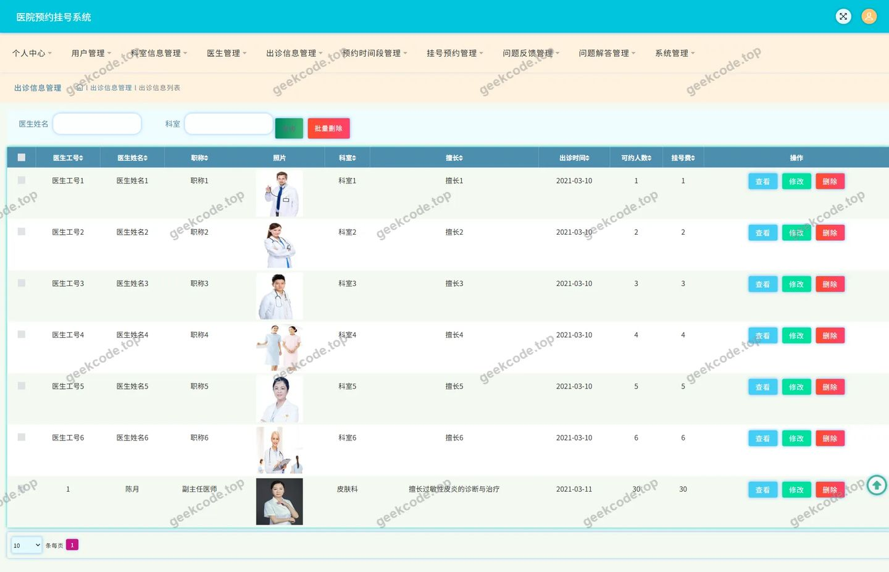
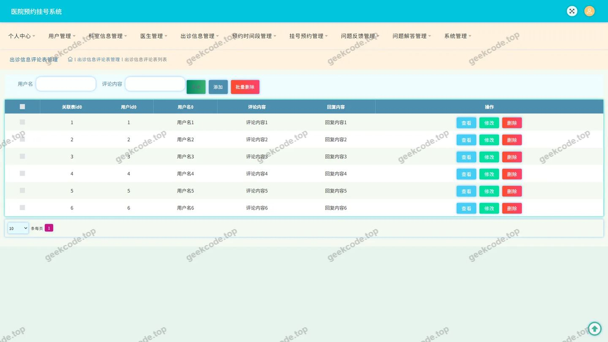
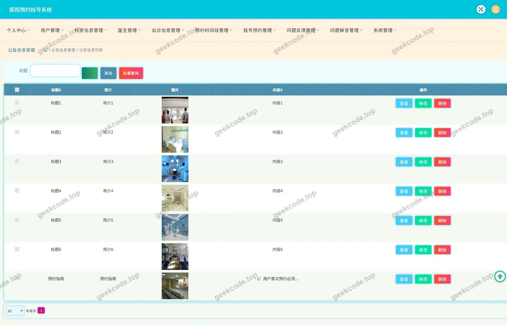
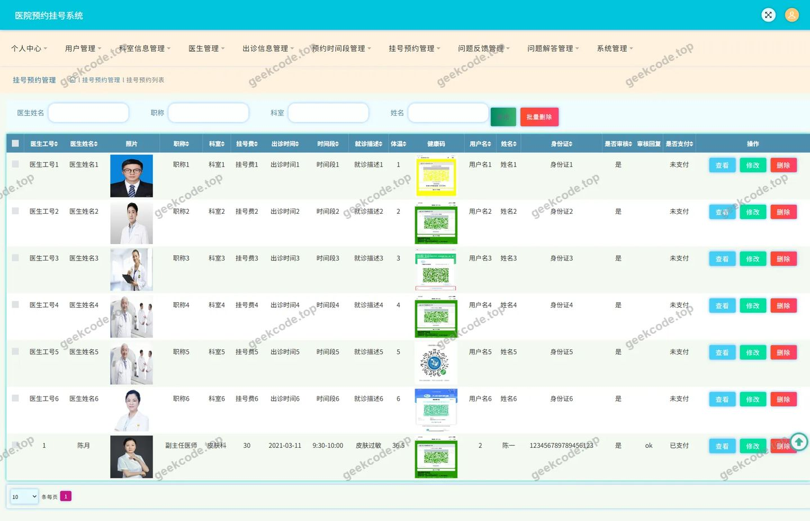
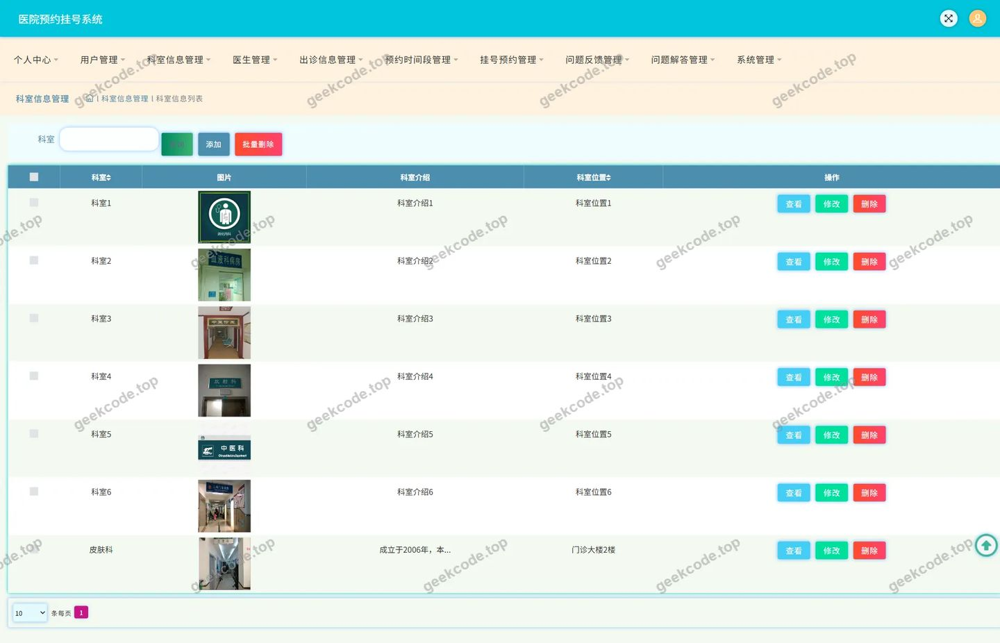
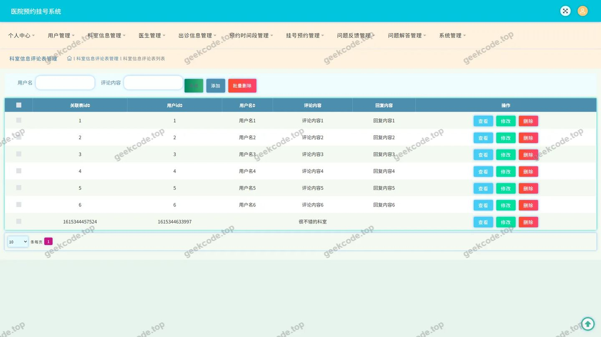
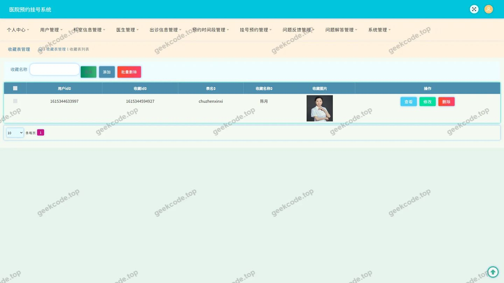
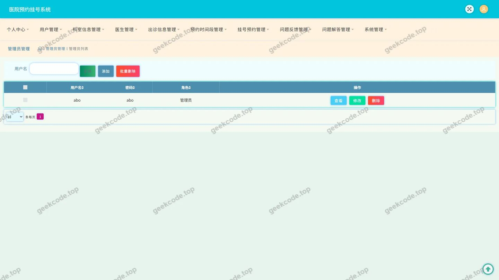

# 医院预约挂号系统(1)

> 🎓 **计算机毕业设计 · 医院预约挂号系统(1)**
>
> 本仓库只放**项目介绍 + 运行截图**（截图是站点带水印的原图，存在仓库 `images/` 里）。
>
> 👉 **完整可运行源码 / 数据库脚本 / 部署文档：[点我获取](https://geekcode.top/archives/%E5%8C%BB%E9%99%A2%E9%A2%84%E7%BA%A6%E6%8C%82%E5%8F%B7%E7%B3%BB%E7%BB%9F-1?utm_source=github)**
>
> 💬 咨询微信：**ir9372**　|　🌐 更多项目：[极客代码 geekcode.top](https://geekcode.top/?utm_source=github)
>
> 📌 项目详情页：<https://geekcode.top/archives/%E5%8C%BB%E9%99%A2%E9%A2%84%E7%BA%A6%E6%8C%82%E5%8F%B7%E7%B3%BB%E7%BB%9F-1?utm_source=github>

<table><td width="230" align="center"> <b>扫码加微信 ir9372</b></td><td valign="middle">📦 源码 = 项目介绍 + 全部运行截图 + 数据库 + 部署文档 👉 点上方任意截图，直接跳到 <b>极客代码 geekcode.top</b> 详情页</td></table>

---

<h1>医院预约挂号系统(1)</h1>
<h2>项目概述</h2>

本项目为医院预约挂号系统，旨在通过数字化手段优化传统医院挂号流程，解决患者排队时间长、信息不对称及资源分配不均等痛点。系统核心功能涵盖科室信息查询、出诊医生排班展示、在线挂号预约、公告发布以及用户个人中心管理（含收藏与评论）。适用人群主要为需要获取医疗服务信息的普通患者及医院管理人员。技术架构上，后端采用基于 Java 的 Spring Boot 框架，结合 MyBatis-Plus 进行数据持久化操作，并使用 Druid 连接池保障数据库访问的高效性与稳定性。系统以 RESTful API 形式提供服务，实现了前后端逻辑分离，具备高内聚、低耦合的特点，能够有效支撑医疗业务场景下的并发请求与数据一致性需求。

<h2>技术架构</h2>
<h3>1. 总体架构设计</h3>

本系统采用典型的 B/S（Browser/Server）架构模式，但在当前配置中表现为纯 API 服务形态（pure-api），即后端仅提供数据接口服务，前端展示层独立部署或暂未纳入本次文档范围。整体架构分为表现层、业务逻辑层和数据访问层。

<ul>
<li><strong>表现层</strong>：负责接收 HTTP 请求并返回 JSON 格式的数据响应。</li>
<li><strong>业务逻辑层</strong>：处理核心业务规则，如挂号状态校验、用户权限验证、评论审核逻辑等。</li>
<li><strong>数据访问层</strong>：通过 ORM 框架映射数据库实体，执行增删改查操作。</li>
</ul>
<h3>2. 核心技术选型</h3>
<ul>
<li><strong>Spring Framework (Core, Context, Web, MVC)</strong>：作为基础容器和 Web 框架，提供依赖注入（DI）、面向切面编程（AOP）以及 MVC 请求分发机制，确保代码模块化和可维护性。</li>
<li><strong>MyBatis-Plus</strong>：在 MyBatis 基础上进行增强，简化了 CRUD 操作的代码量，支持 Lambda 表达式查询，提高了开发效率并减少了 SQL 注入风险。</li>
<li><strong>Druid</strong>：阿里巴巴开源的高性能数据库连接池，具备监控统计功能，能有效防止 SQL 注入并优化数据库连接管理。</li>
<li><strong>JUnit</strong>：用于单元测试，保障核心业务逻辑的正确性和稳定性。</li>
</ul>
<h3>3. 数据库设计要点</h3>

根据 Controller 列表推断，数据库主要包含以下核心实体表：

<ul>
<li><strong>用户表 (User)</strong>：存储注册用户基本信息、登录凭证及个人偏好。</li>
<li><strong>科室信息表 (Keshixinxi)</strong>：记录医院科室名称、简介、位置等信息。</li>
<li><strong>出诊信息表 (Chuzhenxinxi)</strong>：关联医生与科室，记录出诊时间、号源数量、剩余号源等动态数据。</li>
<li><strong>挂号预约表 (Guahaoyuyue)</strong>：记录用户的预约订单，包括预约状态、就诊人信息、关联的出诊 ID。</li>
<li><strong>公告信息表 (News)</strong>：存储医院发布的最新通知、政策解读等内容。</li>
<li><strong>评论与反馈表 (Discuss..., Wentifankui)</strong>：分别存储用户对出诊信息、科室信息的评论，以及用户提交的意见建议。</li>
<li><strong>收藏表 (Storeup)</strong>：记录用户收藏的科室或出诊信息，便于快速访问。</li>
<li><strong>配置表 (Config)</strong>：存储系统全局参数配置。</li>
</ul>
<h2>功能模块</h2>

由于项目类型为 pure-api 且无后台路由，以下功能模块描述侧重于 API 提供的服务能力及对应的业务逻辑。

<h3>前台用户端功能模块</h3>
<table>
<thead>
<tr>
<th align="left">模块名称</th>
<th align="left">对应 Controller</th>
<th align="left">功能描述</th>
</tr>
</thead>
<tbody><tr>
<td align="left"><strong>用户认证与管理</strong></td>
<td align="left"><code>UserController</code></td>
<td align="left">提供用户注册、登录、个人信息修改、密码重置等功能。支持 JWT 或 Session 会话管理。</td>
</tr>
<tr>
<td align="left"><strong>科室信息服务</strong></td>
<td align="left"><code>KeshixinxiController</code></td>
<td align="left">提供科室列表查询、科室详情获取、科室搜索功能。支持按名称或类型筛选。</td>
</tr>
<tr>
<td align="left"><strong>出诊信息查询</strong></td>
<td align="left"><code>ChuzhenxinxiController</code></td>
<td align="left">提供医生出诊排班查询，包括按日期、科室、医生姓名检索。实时显示剩余号源。</td>
</tr>
<tr>
<td align="left"><strong>挂号预约服务</strong></td>
<td align="left"><code>GuahaoyuyueController</code></td>
<td align="left">核心业务模块。支持用户提交挂号申请、查询个人预约记录、取消预约、查看预约状态（待就诊、已完成、已取消）。</td>
</tr>
<tr>
<td align="left"><strong>公告资讯浏览</strong></td>
<td align="left"><code>NewsController</code></td>
<td align="left">提供医院公告列表、公告详情查询，支持分页加载。</td>
</tr>
<tr>
<td align="left"><strong>互动评论系统</strong></td>
<td align="left"><code>DiscusschuzhenxinxiController``DiscusskeshixinxiController</code></td>
<td align="left">允许用户对特定出诊医生或科室发表评价与建议。支持查看评论列表及回复。</td>
</tr>
<tr>
<td align="left"><strong>收藏管理</strong></td>
<td align="left"><code>StoreupController</code></td>
<td align="left">支持用户收藏感兴趣的科室或出诊信息，并在“我的收藏”页面进行统一管理（添加、删除、列表查询）。</td>
</tr>
<tr>
<td align="left"><strong>意见反馈</strong></td>
<td align="left"><code>WentifankuiController</code></td>
<td align="left">提供渠道让用户向医院提交问题反馈或改进建议。</td>
</tr>
<tr>
<td align="left"><strong>通用服务</strong></td>
<td align="left"><code>CommonController``FileController</code></td>
<td align="left">提供验证码生成、字典数据获取、文件上传下载（如头像、附件）等基础公共服务。</td>
</tr>
<tr>
<td align="left"><strong>系统配置</strong></td>
<td align="left"><code>ConfigController</code></td>
<td align="left">获取系统运行所需的基础配置参数（如网站标题、联系方式等）。</td>
</tr>
</tbody></table>
<h3>后台管理端功能模块</h3>

根据提供的上下文信息，项目明确标注“是否有后台: 否”且“后台路由: (无后台路由)”。因此，本项目在当前版本中<strong>不包含独立的后台管理界面</strong>。

所有数据的管理与维护操作（如科室录入、排班更新、公告发布、评论审核等）均通过直接调用上述 API 接口或由运维人员通过数据库工具直接操作完成，未封装专门的可视化管理后台模块。

<h2>用户角色与权限</h2>

基于 Controller 设计和截图功能列表，系统主要涉及以下两类角色。由于缺乏明确的 RBAC（基于角色的访问控制）代码细节，权限划分主要依据业务逻辑推断。

<h3>1. 普通用户（患者）</h3>
<ul>
<li><strong>身份定义</strong>：通过 <code>UserController</code> 注册的终端使用者。</li>
<li><strong>权限范围</strong>：</li>
<li><strong>查看权限</strong>：浏览科室信息、出诊信息、公告信息、他人发表的评论。</li>
<li><strong>操作权限</strong>：</li>
<li>登录/注销、修改个人资料。</li>
<li>发起挂号预约、取消自己的预约。</li>
<li>收藏/取消收藏科室或出诊信息。</li>
<li>发表针对出诊信息和科室信息的评论。</li>
<li>提交问题反馈。</li>
<li><strong>数据隔离</strong>：仅能查看和操作属于自己账号下的预约记录、收藏记录和评论记录。</li>
</ul>
<h3>2. 系统管理员（隐含角色）</h3>
<ul>
<li><strong>身份定义</strong>：虽然无可视化后台，但存在 <code>ConfigController</code> 和基础数据维护需求，暗示存在拥有最高权限的管理账户或通过服务器端直接操作的管理员。</li>
<li><strong>权限范围</strong>：</li>
<li><strong>全量数据访问</strong>：查看所有用户的注册信息、预约记录、评论内容。</li>
<li><strong>内容管理</strong>：</li>
<li>创建、更新、删除科室信息 (<code>Keshixinxi</code>)。</li>
<li>创建、更新、删除出诊排班信息 (<code>Chuzhenxinxi</code>)。</li>
<li>发布、编辑、删除公告信息 (<code>News</code>)。</li>
<li>审核或删除违规评论 (<code>Discuss...</code>)。</li>
<li>查看并处理用户反馈 (<code>Wentifankui</code>)。</li>
<li><strong>系统配置</strong>：修改系统全局参数 (<code>Config</code>)。</li>
<li><strong>注意</strong>：根据现有信息无法确定具体的管理员登录入口或鉴权拦截器配置，通常此类权限由超级管理员 Token 或 IP 白名单限制。</li>
</ul>
<h2>项目特色与创新点</h2>
<ol>
<li>
<strong>API 优先架构设计</strong>：
   系统严格遵循 RESTful 风格设计，将所有业务逻辑封装为标准化的 API 接口。这种架构使得系统具有极高的扩展性，可以轻松对接微信小程序、iOS App、Android App 或 Web 前端，实现多端统一数据源。

</li>
<li>
<strong>高效的持久层交互</strong>：
   引入 MyBatis-Plus 框架，极大简化了常规 CRUD 操作的代码冗余，同时保留了灵活编写复杂 SQL 的能力。配合 Druid 连接池，在高并发挂号场景下能有效维持数据库连接的稳定性，减少连接创建开销。

</li>
<li>
<strong>闭环的用户互动体系</strong>：
   不仅提供基础的查询与预约功能，还构建了“收藏-评论-反馈”的互动闭环。用户可以通过收藏快速定位心仪医生，通过评论分享就医体验，通过反馈促进医院服务改进，增强了系统的用户粘性和社会价值。

</li>
<li>
<strong>模块化与解耦</strong>：
   通过 <code>CommonController</code> 和 <code>FileController</code> 将通用能力（如文件上传、验证码）抽离，避免业务代码重复。各业务模块（科室、出诊、预约）职责单一，符合软件工程的高内聚低耦合原则，便于后期维护和功能迭代。

</li>
</ol>
<h2>部署环境</h2>

为确保系统正常运行，需准备以下软件及硬件环境：

<h3>1. 硬件环境</h3>
<ul>
<li><strong>CPU</strong>：Intel Core i5 及以上或多核服务器处理器。</li>
<li><strong>内存</strong>：建议 8GB RAM 及以上（生产环境建议 16GB+）。</li>
<li><strong>硬盘</strong>：至少 50GB 可用空间，推荐 SSD 以提升 I/O 性能。</li>
</ul>
<h3>2. 软件环境</h3>
<ul>
<li><strong>操作系统</strong>：Windows 10/11, Linux (CentOS 7+, Ubuntu 18.04+) 或 macOS。</li>
<li><strong>Java 运行环境</strong>：JDK 1.8 或 JDK 11（取决于具体 pom.xml 配置，Spring Boot 通常兼容两者）。</li>
<li><strong>数据库</strong>：MySQL 5.7 或 MySQL 8.0。需安装并启动服务，创建对应数据库实例。</li>
<li><strong>构建工具</strong>：Maven 3.6+ 或 Gradle 6.0+（用于项目编译打包）。</li>
<li><strong>Web 服务器</strong>：内置 Tomcat（Spring Boot 默认集成），无需单独安装外部 Tomcat；若需高性能部署，可使用 Nginx 作为反向代理服务器。</li>
</ul>
<h3>3. 网络环境</h3>
<ul>
<li>稳定的互联网连接，开放必要的端口（默认为 8080，可根据配置文件修改）。</li>
<li>若涉及图片/文件存储，需配置本地磁盘路径或对象存储服务（OSS）访问权限。</li>
</ul>
<h2>五、技术特性</h2>
<ul>
<li>使用 MyBatis-Plus 简化数据访问层开发</li>
</ul>
<h2>六、功能模块截图</h2>
<h3>后台管理端</h3>
<h4>页面-出诊信息</h4>

<h4>页面-出诊信息评论</h4>

<h4>页面-登录</h4>

<h4>页面-公告信息</h4>

<h4>页面-挂号预约</h4>

<h4>页面-科室信息</h4>

<h4>页面-科室信息评论</h4>

<h4>页面-收藏</h4>

<h4>页面-用户</h4>

---

## 获取完整源码

| 项目 | 说明 |
| --- | --- |
| 项目名 | 医院预约挂号系统(1) |
| 运行截图 | 本文 9 张（站点带水印原图，仓库 `images/` 目录） |
| 完整源码 | [https://geekcode.top/archives/%E5%8C%BB%E9%99%A2%E9%A2%84%E7%BA%A6%E6%8C%82%E5%8F%B7%E7%B3%BB%E7%BB%9F-1?utm_source=github](https://geekcode.top/archives/%E5%8C%BB%E9%99%A2%E9%A2%84%E7%BA%A6%E6%8C%82%E5%8F%B7%E7%B3%BB%E7%BB%9F-1?utm_source=github) |
| 咨询微信 | **ir9372**（备注：jingpin-yuanma） |
| 更多项目 | [极客代码 geekcode.top](https://geekcode.top/?utm_source=github) |

> 需要源码、部署、改配置、跑不起来等问题，加微信 ir9372 沟通，说明项目名即可。
